# Weekly icon4py review

This workflow reviews icon4py weekly and publishes accepted findings as GitHub
issues in this repository. It also runs locally. The initial scope is
high-severity correctness and performance findings. Each new issue requires
three skeptical reviewers to vote `PASS`.

## Pipeline

The host driver is `scripts/python/weekly_review.py`. The sandboxed pi
orchestrator follows `SKILL.md` and performs the LLM work:

1. Correctness and performance reviewers read `open-issues.json` and
   `changes.diff` from the findings directory and inspect the checkout.
2. Three `icon4py-finding-skeptic` agents evaluate each candidate. Any
   `REJECT` vote rejects the candidate. Three `PASS` votes accept it. Matching
   `DUPLICATE` votes attribute it to an existing issue.
3. Unmatched open issues get three fixedness checks. Three `fixed` votes close
   an issue. At least two `persists` votes add a comment. Other verdicts leave
   it open.
4. The host validates the orchestrator's JSON output and applies the verdicts
   to GitHub. It creates, comments on, closes, and reopens issues. Agents never
   make these changes directly.

## Isolation

The review agents run under `bwrap` in a read-only checkout. They can write
only the findings, reports, and session directories. They cannot run `bash` or
`git`.

Only the host driver has `GITHUB_TOKEN`. The optional network namespace
firewall (`netns_firewall.py`, enabled with `--netns` in CI) restricts egress
to DNS through the host resolvers and HTTPS to `api.inference.cscs.ch`. All
other destinations are blocked, including github.com.

## Issues and labels

The issue tracker is the ledger. Issues labeled `ai-review` are supplied to
later reviews as existing findings through `open-issues.json`.

| Label | Set by | Meaning |
| --- | --- | --- |
| `ai-review` | pipeline | Selects the issues managed by this workflow |
| `ai-review:needs-triage` | pipeline | No human has checked this finding |
| `ai-review:confirmed` | human | A human confirmed the finding |
| `ai-review:invalid` | human | Rejected finding; suppress duplicate reports |

Human authority rules:

- `ai-review:invalid` records a rejected finding. It remains in the reviewing
  inputs for duplicate suppression but never receives a comment, fixedness
  check, close, or reopen. Equivalent findings must not create a new issue.
- The pipeline never reopens an issue closed by a human.
- The pipeline watches issues it closed for 30 days. If a finding is
  re-detected, it reopens the issue and adds a comment.
- Human-closed issues are not supplied as duplicate candidates. A later
  independently validated finding can therefore create a new issue.

Invalid marks the finding itself as rejected. Human closing is a lifecycle
action on one issue, not a request to suppress equivalent findings. Use
`ai-review:invalid` when a finding must not be re-reported.

### State transitions

```mermaid
stateDiagram-v2
    direction LR

    state "Open: ai-review:needs-triage" as NeedsTriage
    state "Open: ai-review:confirmed" as Confirmed
    state "Ignored: ai-review:invalid" as Invalid
    state "Closed by pipeline (completed)" as PipelineClosed
    state "Closed by human" as HumanClosed

    [*] --> NeedsTriage : Create

    NeedsTriage --> Confirmed : Human confirms
    NeedsTriage --> Invalid : Human marks invalid
    NeedsTriage --> HumanClosed : Human closes
    NeedsTriage --> PipelineClosed : Fixed 3/3; comment and close

    Confirmed --> Invalid : Human marks invalid
    Confirmed --> HumanClosed : Human closes
    Confirmed --> PipelineClosed : Fixed 3/3; comment and close

    PipelineClosed --> NeedsTriage : Re-detected within 30 days; reopen and comment
    PipelineClosed --> Confirmed : Re-detected within 30 days; reopen and comment
```



The original triage label is retained when the pipeline closes or reopens an
issue. Duplicate detection and `persists` verdicts add comments without
changing the issue state. All automated actions include a comment with the
run, commit, and relevant verdict.

## Issue format

An accepted finding has `title`, `severity`, `description`, `evidence`,
`file`, `lines`, `symbol`, `suggested_fix`, `reviewer`, `confidence`, and
`tags`. The host validates these fields. `render_issue_body()` writes stable
metadata into an HTML comment and places the finding text into Markdown
sections:

```markdown
<!-- weekly-review:metadata
file: model/common/src/icon4py/model/common/example.py
lines: 100-120
symbol: Example.run
severity: high
first_seen: 2026-11-25
last_seen: 2026-11-25
commit: <full commit SHA>
run_id: weekly-2026-W48
-->
## Summary
The finding description.

## Evidence
The evidence text.

## Suggested fix
The suggested fix.
```

The Details section names the reviewer, commit permalink, tags, and run id.
The host constructs permalinks from the metadata with GitHub's
`blob/<commit>/<file>#L<start>-L<end>` form.

At the next review, `parse_issue_body()` parses the metadata block at the first
colon of each line and reads the Summary and Suggested fix sections. These
fields, the issue title, and its number form the `open-issues.json` entries.
Conversion does not reconstruct the complete original finding. The issue body
is not rewritten after creation, so human edits to the visible sections are
preserved.

## Diff baseline

The host uses the head commit of the previous successful workflow run to
create `changes.diff`. GitHub stores this state in workflow history; the
pipeline does not commit a baseline file.

## Inputs and secrets

The job uses the `weekly-review` deployment environment. Before the first run:

1. Create that environment in the repository Settings.
2. Add `CSCS_INFERENCE_API_KEY` as an environment secret. Remove the
   identically named repository-level secret to make the secret exclusive to
   this environment.
3. Configure the environment separately in the fork and upstream if you run
   both. Environment secrets are not shared between repositories.

A deployment-branch allowlist is optional. Use `weekly-review` to restrict a
fork run to that branch, or `main` to restrict upstream runs. It is not needed
when all collaborators with write access are trusted. Normal fork pull-request
runs do not receive this secret; a branch allowlist additionally protects it
from same-repository pull-request changes.

`GITHUB_TOKEN` is used only by the host driver to read and update issues. The
sandbox does not receive it. `./scripts/run weekly-review labels` creates the required
labels; each publish run also creates any missing label automatically.

## Live output and artifacts

The driver logs main-session events and subagent tool calls with timestamps
and `subagent <id>` prefixes. Use `--artifacts-dir` to retain the overview
report, findings JSON, statistics JSON, and full session transcripts.

The report includes the review outcome, applied GitHub actions, elapsed times,
and per-session token usage. Token totals cover every model turn, including
repeated context and cached tokens. Reviewer roles are inferred from system
prompts and shown as `unknown` when no prompt matches.

## Run locally

```bash
# One-time label creation.
GITHUB_TOKEN=... ./scripts/run weekly-review labels

# Read the tracker and exercise the pipeline without changing it.
# Defaults to msimberg/icon4py; --repo selects another repository.
CSCS_INFERENCE_API_KEY=... ./scripts/run weekly-review run \
  --artifacts-dir /tmp/weekly-review-artifacts

# Publish changes to the issue tracker.
CSCS_INFERENCE_API_KEY=... GITHUB_TOKEN=... \
  ./scripts/run weekly-review run --publish
```

Local runs need `bwrap` (bubblewrap) and `pi` on PATH. The optional `--netns`
firewall additionally needs root, `iptables`, and `nftables`. Configure it with:

```bash
sudo python3 scripts/data/weekly-review/netns_firewall.py setup api.inference.cscs.ch
./scripts/run weekly-review run --netns
sudo python3 scripts/data/weekly-review/netns_firewall.py teardown
```

## Files

```
.github/workflows/
  weekly-review.yml           # CI workflow
scripts/python/
  weekly_review.py            # Host driver; run via scripts/run weekly-review
scripts/data/weekly-review/
  SKILL.md                    # Orchestrator workflow
  agents/                     # Reviewer, skeptic, and fixedness agents
  netns_firewall.py           # Network namespace firewall
  settings.json               # pi provider and packages
  models.json                 # Model definitions; keys come from environment variables
  README.md                   # This document
```
